<div align="center">

# Enterprise SSO

**A self-hosted identity provider and admin console.** It provides single sign-on for your applications over
OAuth 2.0 and OpenID Connect, with server-side sessions, TOTP multi-factor authentication, role-based access control
and a full security audit trail.

[](https://github.com/vanquan3008/user-manager/actions/workflows/ci.yml)


[Quick start](#quick-start) · [Features](#features) · [Architecture](#architecture) · [API](#api-reference) ·
[Configuration](#configuration) · [Security](#security-model) · [Integrate an app](user-manager-be/docs/THIRD_PARTY_APP_INTEGRATION.md)

<br/>

<picture>
  <source media="(prefers-color-scheme: dark)" srcset="docs/screenshots/dashboard-dark.png">
  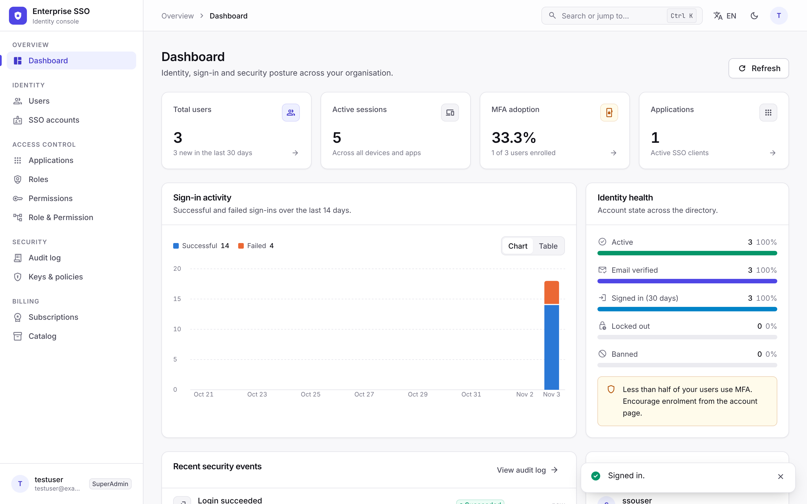
</picture>

</div>

---

## Contents

- [Highlights](#highlights)
- [Quick start](#quick-start)
- [Screenshots](#screenshots)
- [Features](#features)
- [Architecture](#architecture)
- [Authentication flows](#authentication-flows)
- [Authorization model](#authorization-model)
- [Database design](#database-design)
- [API reference](#api-reference)
- [Audit events](#audit-events)
- [Configuration](#configuration)
- [Local development](#local-development)
- [Database migrations](#database-migrations)
- [Docker deployment](#docker-deployment)
- [Testing and CI](#testing-and-ci)
- [Security model](#security-model)
- [Production checklist](#production-checklist)
- [Troubleshooting](#troubleshooting)
- [Known limitations](#known-limitations)
- [Contributing](#contributing)

---

## Highlights

| | |
|---|---|
| 🔐 **Standards-based SSO** | Authorization code flow with **mandatory PKCE (S256)**, ID tokens, UserInfo, discovery, JWKS, RFC 7009 revocation and OIDC back-channel logout |
| 🧾 **Revocable sessions** | Every sign-in is a server-side session. Access tokens carry `sid`, so signing out a device rejects its tokens immediately |
| 🔁 **Refresh-token rotation** | Tokens rotate on every use, are stored only as SHA-256 hashes, and **reuse detection** revokes a stolen token's session |
| 🗝️ **Managed signing keys** | An RS256 key ring in the database, encrypted with ASP.NET Data Protection, with automatic rotation, emergency revocation and a JWKS grace window |
| 📱 **TOTP MFA** | RFC 6238 authenticator apps, replay protection and single-use recovery codes. MFA is enforced on every sign-in path |
| 🛡️ **Fine-grained RBAC** | `RESOURCE.ACTION` permissions with wildcards, global roles, application roles, memberships and subscription entitlements |
| 📜 **Audit trail** | 35 event types with actor, target, IP, user agent, session and correlation id; filters, CSV export and retention |
| 🎨 **Polished console** | Light/dark themes, responsive layout, a ⌘K command palette, and English / Tiếng Việt / 中文 |

---

## Quick start

Requirements: Docker with Compose v2.

```bash
git clone https://github.com/vanquan3008/user-manager.git && cd user-manager
cp .env.example .env        # set POSTGRES_PASSWORD, ADMIN_EMAIL, ADMIN_PASSWORD, Cloudinary keys, public URLs
docker compose up -d --build
```

| Service | URL |
|---|---|
| Admin console | http://localhost:8080 |
| Identity API | http://localhost:5004 |
| Discovery | http://localhost:5004/.well-known/openid-configuration |
| Health | http://localhost:5004/health/ready |

Sign in with `ADMIN_EMAIL` / `ADMIN_PASSWORD`, then open **My account → Security** and turn on two-factor authentication.

> [!TIP]
> If you are running the API and console from source, see [Local development](#local-development).

---

## Screenshots

| Sign-in | Command palette (⌘K / Ctrl K) |
|---|---|
| 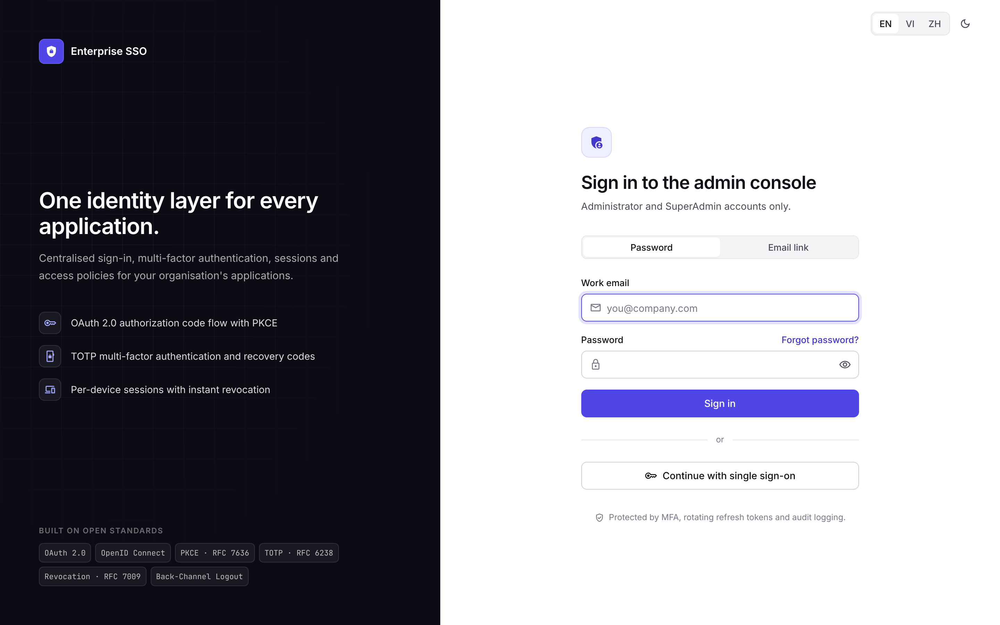 | 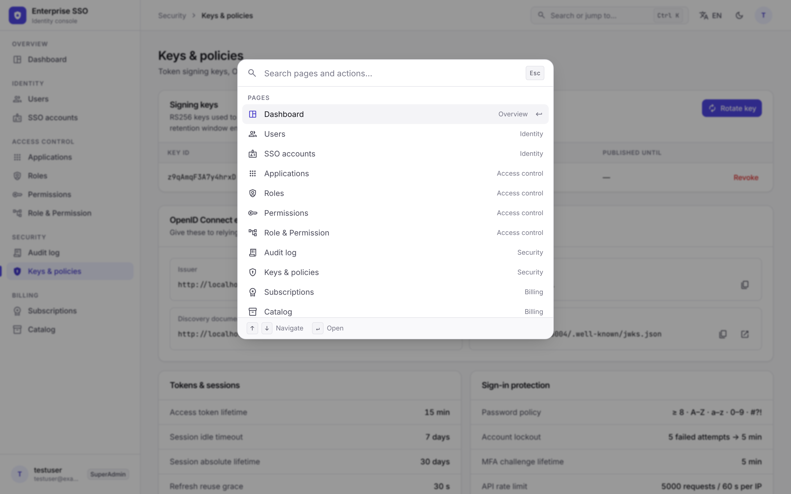 |
| **Users** | **Application (OAuth client)** |
| 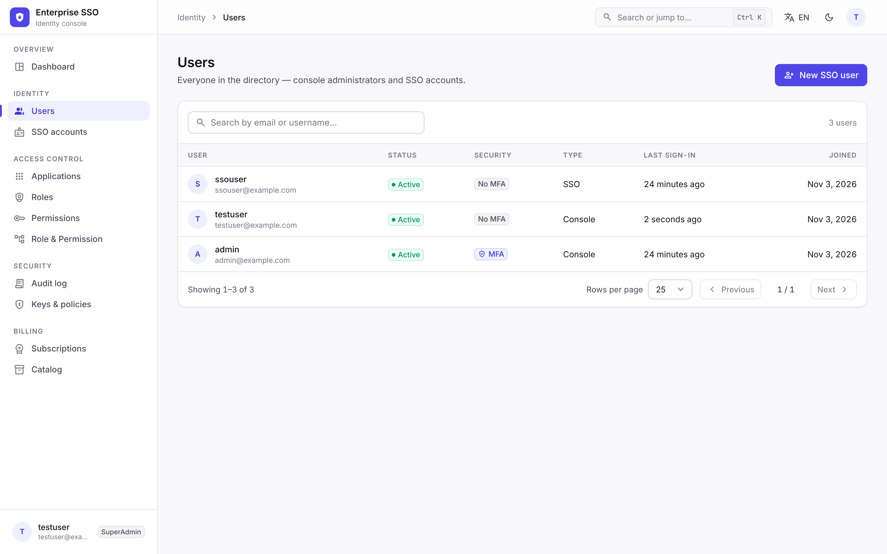 | 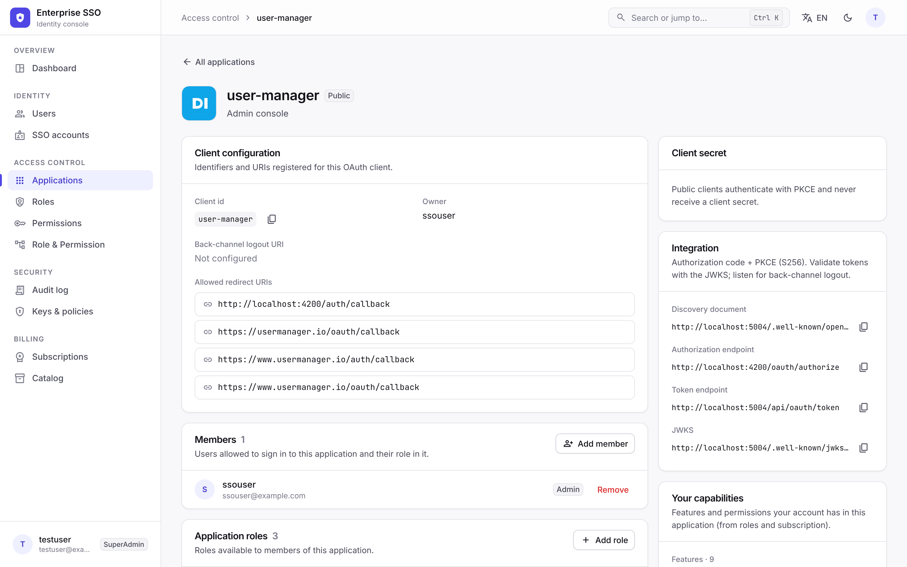 |
| **Audit log** | **Sessions & devices** |
| 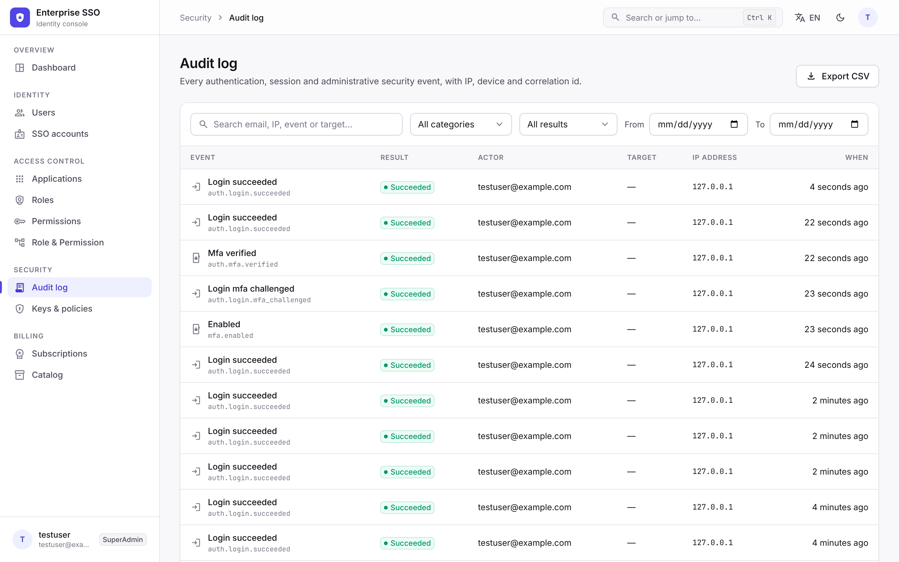 | 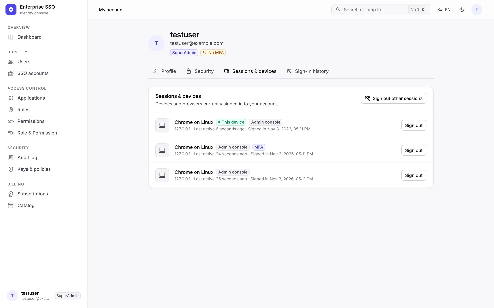 |
| **Signing keys & security policy** | **Dashboard (dark)** |
| 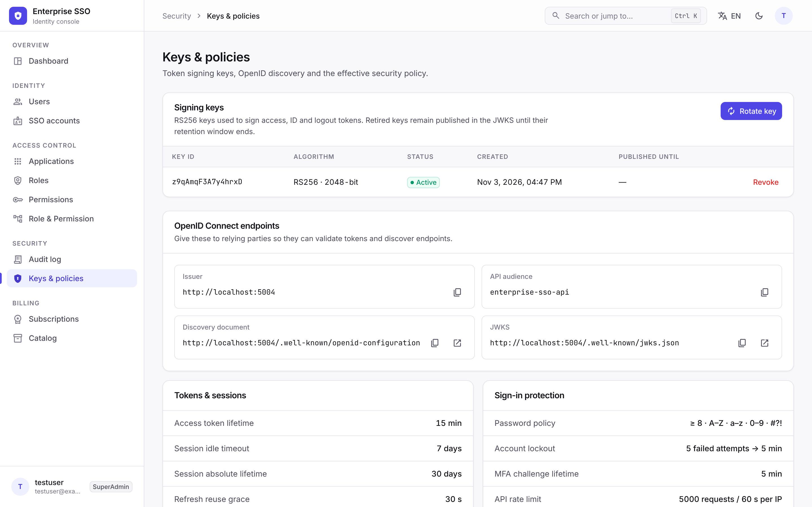 | 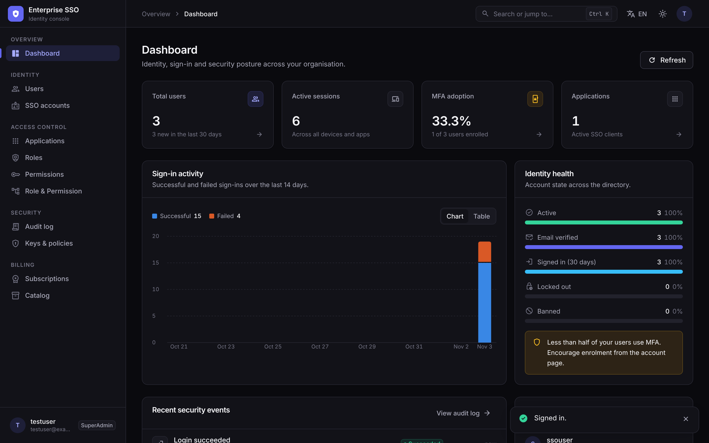 |

---

## Features

### Single sign-on (OAuth 2.0 / OpenID Connect)

| Capability | Details |
|---|---|
| Authorization code + PKCE | `response_type=code` only, `S256` required, exact redirect-URI matching against the application's allow-list |
| Hosted sign-in & consent | `/sso-login` and `/oauth/authorize`. Consent is remembered per user, application and scope |
| ID tokens | `openid` scope. Claims: `sub`, `aud`, `nonce`, `sid`, `auth_time`, `amr`, plus `email` and `profile` claims when those scopes are granted |
| Token endpoint | Form-encoded, standard RFC 6749 responses. Client auth: `client_secret_basic`, `client_secret_post` or `none` (public clients). The legacy JSON body is still accepted |
| Authorization codes | Hashed at rest, 2-minute lifetime, single use even under concurrent requests. **A replayed code revokes the tokens issued from it** |
| Refresh tokens | Rotated on every use. **Reusing a rotated token revokes the whole token family** for that client |
| UserInfo · Revocation · Discovery · JWKS | `/api/oauth/userinfo`, RFC 7009 `/api/oauth/revoke`, `/.well-known/openid-configuration`, `/.well-known/jwks.json` |
| Single logout | OAuth grants are bound to the SSO session. Ending the session revokes them and POSTs an OIDC **back-channel logout** token (`logout+jwt`) to each affected application |

### Sessions, tokens and keys

| Capability | Details |
|---|---|
| Server-side sessions | One row per device: IP, user agent, authentication method, idle (7 d) and absolute (30 d) expiry |
| Access tokens | RS256 JWT with `typ: at+jwt`, 15 min, carries `sid`. The session is checked on every request (validation cache ≤ 15 s) |
| Refresh cookie | Opaque 256-bit token. `HttpOnly` cookie limited to `/api/auth`, rotated, SHA-256 hashed, 30 s multi-tab grace window |
| Session control | Users list and sign out individual devices or "sign out everywhere"; admins can sign a user out of all sessions |
| Automatic revocation | Password change signs out other sessions. Password reset, ban and admin revoke end every session and OAuth grant |
| Key ring | RS256 keys in the database, private halves encrypted with Data Protection. Rotation every 90 days, manual rotate/revoke in the console, retired keys published for 7 days |

### Multi-factor authentication

| Capability | Details |
|---|---|
| TOTP (RFC 6238) | Works with Google Authenticator, Microsoft Authenticator, 1Password and similar apps. Enrolment by QR code or manual key |
| Replay protection | The accepted time-step is stored, so a code cannot be used twice |
| Recovery codes | 10 single-use codes, stored as SHA-256 hashes and regenerable |
| Coverage | Console sign-in, hosted SSO sign-in and email magic links. Failed codes count towards account lockout |
| Admin reset | Administrators with `SECURITY.MANAGE` can reset MFA for a user who lost their device |

### Identity, access and billing

| Area | Details |
|---|---|
| Users | Console and managed SSO accounts. Self-registration with email verification, passwordless email links, password reset, ban/unban |
| Roles & permissions | Global roles, a permission catalog (`RESOURCE.ACTION`, `RESOURCE.*`) and batch role ↔ permission mapping. The console prevents renaming or deleting built-in roles |
| Applications | Public or confidential OAuth clients, redirect-URI allow-list, back-channel logout URI, logo, client secret that is shown once and can be rotated |
| Membership | Application roles and members, per-application capabilities endpoint |
| Subscriptions | Plans per application (pricing, quotas, features), member subscriptions (activate, upgrade, extend, cancel, history) that drive entitlements |

### Operations and console

| Area | Details |
|---|---|
| Audit log | 35 event types, filter by search/category/result/user/date, CSV export (safe against spreadsheet formula injection), retention purge |
| Dashboard | Users, MFA adoption, active sessions, applications, account health and a 14-day sign-in success/failure chart (with a table view) |
| Protection | Per-IP rate limits (global plus a stricter limit for credential endpoints), lockout after 5 failures, security headers, forwarded headers trusted only from known proxies |
| Observability | `/health/live`, `/health/ready` (database + signing key), structured JSON logs with correlation ids |
| Console UX | Light/dark themes, responsive down to phone widths, ⌘K command palette, keyboard-accessible menus and dialogs, i18n (EN · VI · 中文) |

---

## Architecture

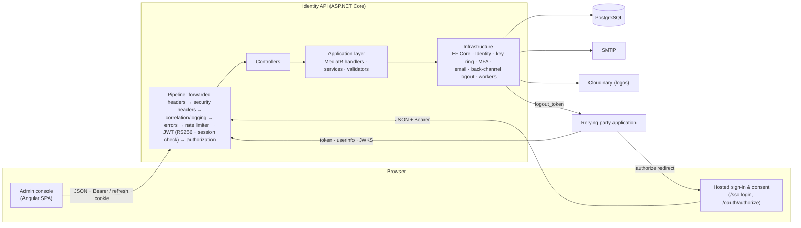

| Layer | Stack |
|---|---|
| API | .NET 10, ASP.NET Core, ASP.NET Core Identity, MediatR 12, FluentValidation 12, Serilog |
| Data | EF Core 10 + Npgsql (PostgreSQL 16), Data Protection keys stored in the database |
| OAuth extras | OpenIddict 5.8 (legacy `/connect/token` only) |
| Console | Angular 21 (standalone components, signals), TypeScript 5.9, Tailwind CSS 3, `qrcode` |
| Delivery | Multi-stage Dockerfiles (non-root), nginx-unprivileged, Docker Compose, GitHub Actions |

### Project structure

```
.
├── docker-compose.yml           postgres + api + web
├── .env.example                 settings for docker compose
├── docs/screenshots/            images used in this README
├── user-manager-be/
│   ├── UserService.Domain/          entities, value objects, domain events, repository interfaces (no EF / ASP.NET)
│   ├── UserService.Application/     use cases (commands/queries), sessions, tokens, OAuth, audit, TOTP, DTOs, validators
│   ├── UserService.Infrastructure/  DbContext, configurations, migrations, repositories, Identity, key ring, MFA,
│   │                                email, outbox + security maintenance workers, seeders
│   ├── UserService.Api/             controllers, middleware, authN/Z, rate limiting, health, Program.cs, Dockerfile
│   ├── UserService.Tests/           unit + WebApplicationFactory integration tests (incl. architecture rules)
│   └── docs/THIRD_PARTY_APP_INTEGRATION.md
└── user-manager-fe/src/app/
    ├── core/        services, interceptors, guards, models, i18n
    ├── layout/      application shell (sidebar, top bar, command palette)
    ├── shared/      design-system components (drawer, dialog, toast, tables, charts, auth shell, MFA step…)
    └── pages/       login/*, dashboard, users, applications, roles, permissions, role-permission,
                     audit-logs, system, account, billing/*
```

An architecture test enforces the dependency rules: the domain layer depends on nothing, and the application layer
never references EF Core or infrastructure.

Two background workers run inside the API:
- **Outbox processor:** delivers domain events (for example verification emails) after the transaction commits.
- **Security maintenance:** reloads the key ring every 5 minutes and rotates it when due. Every hour it purges expired
  sessions, codes and refresh tokens, and applies audit-log retention.

---

## Authentication flows

### Single sign-on for a relying party

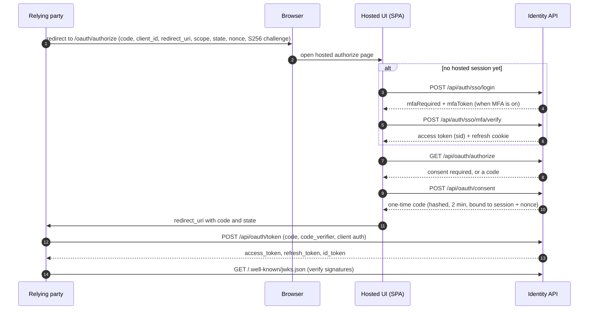

### Refresh-token rotation and reuse detection

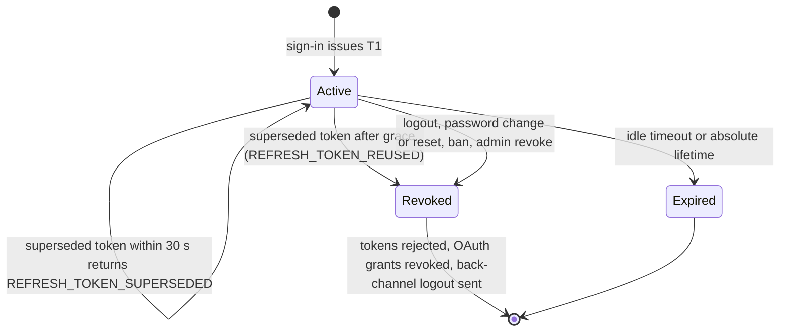

### Console sign-in with MFA

1. `POST /api/auth/login` checks the password, with lockout. Unknown users and wrong passwords both get the same
   `401 INVALID_CREDENTIALS`. Account state (locked, banned) is only revealed after a correct password.
2. With MFA on, the response is `{ mfaRequired: true, mfaToken }`, with no tokens and no cookie. The token is a
   Data-Protection-encrypted challenge that expires in 5 minutes.
3. `POST /api/auth/mfa/verify` with a TOTP or recovery code opens the session and returns an access token with
   `amr=mfa` and the refresh cookie.

---

## Authorization model

- Endpoints are protected by permission policies (`HasPermission:USER.READ`, …). A user's permissions come from
  their global roles. For application-scoped tokens they also come from the application role and subscription plan.
- `SuperAdmin` and `Admin` are seeded with every permission. `User` and `Guest` start empty.
- Unauthenticated requests get `401 UNAUTHORIZED`; authenticated requests without the permission get `403 FORBIDDEN`.
  Both return the same JSON envelope.
- The admin console additionally requires the `Admin` or `SuperAdmin` role.
- Signing in to an application requires an active membership and subscription (`SuperAdmin` bypasses this).

<details>
<summary><b>Permission catalog</b></summary>

| Resource | Permissions |
|---|---|
| Users | `USER.READ` `USER.CREATE` `USER.UPDATE` `USER.DELETE` `USER.MANAGE` |
| Roles | `ROLE.READ` `ROLE.CREATE` `ROLE.UPDATE` `ROLE.DELETE` `ROLE.MANAGE` |
| Permissions | `PERMISSION.READ` `PERMISSION.CREATE` `PERMISSION.MANAGE` |
| Applications | `APPLICATION.READ` `APPLICATION.CREATE` `APPLICATION.UPDATE` `APPLICATION.DELETE` `APPLICATION.MANAGE` `APPLICATION.*` |
| Members | `MEMBER.READ` `MEMBER.INVITE` `MEMBER.REMOVE` |
| Subscriptions | `SUBSCRIPTION.READ` `SUBSCRIPTION.MANAGE` `SUBSCRIPTION.ACTIVATE` `SUBSCRIPTION.UPGRADE` `SUBSCRIPTION.EXTEND` `SUBSCRIPTION.CANCEL` |
| Security | `SECURITY.READ` `SECURITY.MANAGE` `AUDIT_LOG.READ` |
| Reports | `REPORT.READ` `REPORT.EXPORT` |

</details>

---

## Database design

The PostgreSQL schema is managed by EF Core migrations (`UserService.Infrastructure/Migrations`).

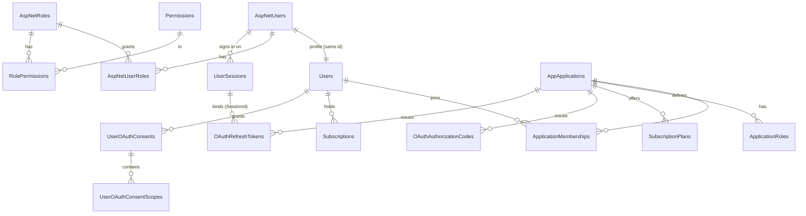

| Table | Purpose |
|---|---|
| `AspNetUsers`, `AspNetRoles`, `AspNetUserRoles`, `AspNetUserTokens` | Identity: PBKDF2 password hashes, lockout, `TwoFactorEnabled`, `LastTotpTimeStep`, authenticator key, hashed recovery codes |
| `Users` | Domain profile (name, username, SSO flag, preferences) |
| `UserSessions` | Signed-in devices: current and previous refresh-token hash, kind, auth method, IP, user agent, expiry, revocation reason, concurrency token |
| `Permissions`, `RolePermissions` | Permission catalog and global role grants |
| `AppApplications`, `ApplicationRoles`, `ApplicationMemberships`, `ApplicationOAuthScopes` | OAuth clients (BCrypt-hashed secret, redirect URIs, back-channel URI), roles, members |
| `OAuthAuthorizationCodes` | Code hash, PKCE challenge, nonce, session id, expiry, single-use concurrency token |
| `OAuthRefreshTokens` | Token hash, scopes, session id, expiry, revocation reason (`rotated` enables reuse detection) |
| `UserOAuthConsents`, `UserOAuthConsentScopes` | Remembered consent |
| `SubscriptionPlans`, `PlanFeatures`, `SubscriptionPlanPermissions`, `Subscriptions`, `ApplicationSubscriptions`, `Features` | Plans, entitlements, subscriptions |
| `MagicLinkTokens` | Verification, reset and passwordless links: SHA-256 hash only, 15 min, single use |
| `AuditLogs` | Append-only security events, indexed by time, type, category, actor and target |
| `SigningKeys` | RS256 key ring (public PEM, encrypted private key, retired/revoked timestamps) |
| `DataProtectionKeys` | Shared ASP.NET Core Data Protection key ring |
| `OutboxMessages` | Transactional outbox |
| `OpenIddict*` | Legacy `/connect/token` endpoint |

One-time artifacts (sessions, codes, refresh tokens, magic links) use optimistic concurrency tokens. Each can be
redeemed or rotated exactly once, even under parallel requests.

---

## API reference

**Envelope:** `{ success, data, message, error: { code, message, errors } }`. Paged lists also include `totalCount`, `pageNumber` and `pageSize`.
Interactive docs are served at `/swagger` when `AppSettings__Swagger__Enabled=true`.

<details open>
<summary><b>Authentication</b> · <code>/api/auth</code> (rate-limited credential policy)</summary>

| Method | Path | Description |
|---|---|---|
| POST | `/register` | Self-registration (`User` role) and verification email |
| POST | `/login` | Console sign-in. May return `mfaRequired` + `mfaToken` |
| POST | `/mfa/verify` | Finish console sign-in with a TOTP or recovery code |
| POST | `/sso/login` · `/sso/mfa/verify` | Hosted SSO sign-in |
| POST | `/refresh` | Rotate the refresh cookie (needs `X-Requested-With` when using the cookie) |
| POST | `/logout` | `{ allSessions?: bool }`: revokes session(s) and OAuth grants, sends back-channel logout |
| POST | `/passwordless/request` · `/magic-link/verify` · `/magic-link/resend` | Email-link sign-in |
| GET · POST | `/verify-email` | Email verification |
| POST | `/password/reset-request` · `/password/reset` | Password reset (revokes every session) |
| POST | `/password/change` | Change password (authenticated; signs out other sessions) |

</details>

<details>
<summary><b>OAuth 2.0 / OpenID Connect</b></summary>

| Method | Path | Description |
|---|---|---|
| GET | `/.well-known/openid-configuration` · `/.well-known/oauth-authorization-server` | Discovery |
| GET | `/.well-known/jwks.json` | Public signing keys (active + retired) |
| GET | `/api/oauth/authorize` | Called by the hosted UI with the user's SSO token |
| POST | `/api/oauth/consent` | Approve the requested scopes |
| POST | `/api/oauth/token` | `authorization_code` / `refresh_token` (form or JSON) |
| GET · POST | `/api/oauth/userinfo` | Claims for the granted scopes |
| POST | `/api/oauth/revoke` | RFC 7009 token revocation |
| POST | `/connect/token` | Legacy OpenIddict endpoint (most grants disabled) |

```bash
curl -s http://localhost:5004/api/oauth/token \
  -d grant_type=authorization_code -d client_id=my-app \
  -d redirect_uri=https://app.example.com/callback \
  -d code="$CODE" -d code_verifier="$VERIFIER"
```

```json
{ "access_token": "eyJ…", "token_type": "Bearer", "expires_in": 900,
  "refresh_token": "…", "scope": "openid profile email", "id_token": "eyJ…" }
```

Step-by-step client guide: [THIRD_PARTY_APP_INTEGRATION.md](user-manager-be/docs/THIRD_PARTY_APP_INTEGRATION.md).

</details>

<details>
<summary><b>My account</b> · <code>/api/account</code> (any signed-in user)</summary>

| Method | Path | Description |
|---|---|---|
| GET | `/sessions` | My sessions and devices |
| DELETE | `/sessions/{sessionId}` | Sign out one device |
| POST | `/sessions/revoke-others` | Sign out every other device |
| GET | `/mfa` | MFA status and remaining recovery codes |
| POST | `/mfa/setup` · `/mfa/enable` · `/mfa/disable` | Enrol (QR/secret), confirm with a code, turn off (code required) |
| POST | `/mfa/recovery-codes` | Regenerate recovery codes |
| GET | `/activity` | My sign-in and security history |

</details>

<details>
<summary><b>Users</b> · <code>/api/users</code></summary>

| Method | Path | Permission |
|---|---|---|
| GET | `/?search&type=sso\|console&page&pageSize` | `USER.READ` |
| GET | `/me` | signed in |
| GET | `/{userId}` | `USER.READ` |
| POST · DELETE | `/{userId}/roles/upgrade` · `/{userId}/roles/{roleName}` | `ROLE.MANAGE` |
| POST | `/sso` | `USER.MANAGE` (create a managed SSO account) |
| GET · POST · DELETE | `/sso/{ssoUserId}/applications[/{applicationId}]` | `USER.MANAGE` |
| POST | `/{userId}/ban` · `/{userId}/unban` | `USER.MANAGE` |
| GET | `/{userId}/sessions` · `/{userId}/mfa` | `USER.READ` |
| POST | `/{userId}/sessions/revoke` | `USER.MANAGE` |
| POST | `/{userId}/mfa/reset` | `SECURITY.MANAGE` |

</details>

<details>
<summary><b>Applications</b> · <code>/api/applications</code></summary>

| Method | Path | Permission |
|---|---|---|
| GET | `/` · `/{applicationId}` | `APPLICATION.READ` |
| POST | `/` | `APPLICATION.CREATE` |
| DELETE | `/{applicationId}` | `APPLICATION.MANAGE` |
| GET · POST | `/{applicationId}/credentials` · `/credentials/rotate` | `APPLICATION.MANAGE` |
| PUT | `/{applicationId}/logo` | `APPLICATION.MANAGE` |
| GET · POST · DELETE | `/{applicationId}/users[/{userId}]` | `USER.MANAGE` |
| GET | `/{applicationId}/roles` | `ROLE.READ` |
| POST · PUT · DELETE | `/{applicationId}/roles[/{roleName}]` | `ROLE.MANAGE` |
| GET | `/{applicationId}/me/capabilities` | signed in |
| POST · DELETE | `/api/files/upload` · `/api/files` | `APPLICATION.CREATE` or `APPLICATION.MANAGE` / `APPLICATION.MANAGE` |

</details>

<details>
<summary><b>Roles & permissions</b></summary>

| Method | Path | Permission |
|---|---|---|
| GET | `/api/roles` · `/api/roles/{roleId}` | `ROLE.READ` |
| POST · PUT · DELETE | `/api/roles[/{roleId}]` | `ROLE.MANAGE` |
| GET | `/api/permissions` · `/api/permissions/{permissionId}` | `PERMISSION.READ` |
| POST | `/api/permissions` | `PERMISSION.CREATE` |
| GET | `/api/permissions/{roleId}/permissions` | `ROLE.READ` |
| POST · DELETE | `/api/permissions/{roleId}/permissions[/batch]` · `/{permissionId}` | `ROLE.MANAGE` |

</details>

<details>
<summary><b>Subscriptions</b> · <code>/api/subscriptions</code></summary>

| Method | Path | Permission |
|---|---|---|
| GET | `/plans` | `SUBSCRIPTION.READ` |
| POST · PUT · DELETE | `/plans[/{planId}]` | `SUBSCRIPTION.MANAGE` |
| POST | `/activate` · `/upgrade` · `/extend` · `/cancel` | `SUBSCRIPTION.ACTIVATE` / `UPGRADE` / `EXTEND` / `CANCEL` |
| GET | `/active` · `/history` | signed in |

</details>

<details>
<summary><b>Security operations</b></summary>

| Method | Path | Permission |
|---|---|---|
| GET | `/api/audit-logs?search&category&succeeded&userId&from&to&page&pageSize` | `AUDIT_LOG.READ` |
| GET | `/api/audit-logs/export` (CSV, same filters) | `AUDIT_LOG.READ` |
| GET | `/api/dashboard/summary` | `USER.READ` |
| GET | `/api/system/signing-keys` · `/api/system/security-settings` | `SECURITY.READ` |
| POST | `/api/system/signing-keys/rotate` · `/api/system/signing-keys/{keyId}/revoke` | `SECURITY.MANAGE` |
| GET | `/health/live` · `/health/ready` · `/health` | public |

</details>

<details>
<summary><b>Error codes</b></summary>

| HTTP | `error.code` | Meaning |
|---|---|---|
| 401 | `INVALID_CREDENTIALS` | Wrong email or password (same response for unknown users) |
| 401 | `ACCOUNT_LOCKED` · `ACCOUNT_DISABLED` | Lockout after failed attempts · banned/inactive account |
| 401 | `WRONG_LOGIN_ENDPOINT` | Console account on the SSO endpoint, or the reverse |
| 401 | `INVALID_MFA_CHALLENGE` · `INVALID_MFA_CODE` · `MFA_NOT_ENABLED` | MFA step expired or tampered with · wrong/reused code · MFA not set up |
| 401 | `INVALID_REFRESH_TOKEN` · `SESSION_EXPIRED` | Unknown/expired refresh token · session ended |
| 401 | `REFRESH_TOKEN_SUPERSEDED` | A parallel tab already rotated the token (retry with the new cookie) |
| 401 | `REFRESH_TOKEN_REUSED` | A rotated token was replayed; the session has been revoked |
| 401 · 403 | `UNAUTHORIZED` · `FORBIDDEN` | Missing/invalid token · missing permission |
| 403 | `CSRF_HEADER_REQUIRED` | A cookie-authenticated refresh/logout without `X-Requested-With` |
| 409 | — | Concurrency conflict (the one-time artifact was already used) |
| 429 | `RATE_LIMITED` | Per-IP limit exceeded (`Retry-After` header) |
| 400 · 401 | `invalid_request` · `invalid_client` · `invalid_grant` · … | OAuth errors from `/api/oauth/token` (RFC 6749 format) |

</details>

---

## Audit events

Each event records the actor, target, IP address, user agent, session id, correlation id and outcome.

| Category | Events |
|---|---|
| Authentication | `auth.login.succeeded` `auth.login.failed` `auth.login.mfa_challenged` `auth.mfa.verified` `auth.mfa.failed` `auth.magic_link.login` `auth.registered` `auth.logout` `auth.token.refreshed` `auth.token.reuse_detected` `auth.password.changed` `auth.password.reset_requested` `auth.password.reset` |
| Sessions | `session.revoked` `session.revoked_all` |
| MFA | `mfa.enabled` `mfa.disabled` `mfa.recovery_codes.regenerated` |
| OAuth | `oauth.code.issued` `oauth.token.issued` `oauth.token.failed` `oauth.code.replay_detected` `oauth.refresh.reuse_detected` `oauth.consent.granted` `oauth.tokens.revoked` |
| Users | `user.banned` `user.unbanned` `user.role.added` `user.role.removed` `user.sso.created` |
| Applications | `application.created` `application.deleted` `application.secret.rotated` |
| Keys | `security.signing_key.rotated` `security.signing_key.revoked` |

Recommended alerts: `auth.token.reuse_detected`, `oauth.code.replay_detected`, `oauth.refresh.reuse_detected`,
`security.signing_key.revoked`, and bursts of `auth.login.failed` from one IP.

---

## Configuration

Every setting in `appsettings.json` can be overridden with an environment variable, using `__` as the separator
(e.g. `AppSettings__Jwt__Issuer`). The connection string is resolved from `ConnectionStrings__UserDatabase`, then
`DATABASE_URL`, then `POSTGRES_HOST/PORT/DB/USER/PASSWORD`.

<details open>
<summary><b>Required</b> (the API refuses to start without these)</summary>

| Variable | Description |
|---|---|
| `ConnectionStrings__UserDatabase` | Npgsql connection string |
| `AppSettings__FrontendBaseUrl` | Console/hosted UI URL: email links, `authorization_endpoint`, CORS fallback |
| `AppSettings__Jwt__Issuer` · `AppSettings__Jwt__Audience` | Use the public API URL as the issuer |
| `AppSettings__Cloudinary__CloudName` · `__ApiKey` · `__ApiSecret` | Application logo uploads |
| `Admin__Email` · `Admin__Password` | SuperAdmin account created on first start |
| `SEED_APP_NAME` · `SEED_APP_API_KEY` | First-party application; its client id must match `NG_APP_OAUTH_CLIENT_ID` |

</details>

<details>
<summary><b>Sessions, tokens and keys</b></summary>

| Variable | Default | Description |
|---|---|---|
| `AppSettings__Jwt__AccessTokenExpirationMinutes` | `15` | Access and ID token lifetime |
| `AppSettings__Jwt__RefreshTokenExpirationDays` | `7` | Session idle timeout, OAuth refresh-token lifetime |
| `AppSettings__Security__SessionAbsoluteLifetimeDays` | `30` | Maximum session age |
| `AppSettings__Security__RefreshTokenReuseGraceSeconds` | `30` | Multi-tab grace window |
| `AppSettings__Security__SessionValidationCacheSeconds` | `15` | How fast revocation reaches other instances |
| `AppSettings__Security__MfaChallengeMinutes` | `5` | MFA step lifetime |
| `AppSettings__Security__SigningKeys__RotationDays` | `90` | `0` disables automatic rotation |
| `AppSettings__Security__SigningKeys__RetiredKeyRetentionDays` | `7` | Must exceed the access-token lifetime |
| `AppSettings__Security__DataProtectionCertificatePath` · `…Password` | — | PFX that encrypts Data Protection keys at rest |
| `AppSettings__Security__AuditLogRetentionDays` | `365` | `0` keeps audit logs forever |

</details>

<details>
<summary><b>Network, limits and email</b></summary>

| Variable | Default | Description |
|---|---|---|
| `AppSettings__ApiPublicBaseUrl` | request host | Public API URL in discovery |
| `AppSettings__Cors__AllowedOrigins__N` | — | Allowed SPA origins (credentials allowed) |
| `AppSettings__Security__ForwardedHeaders__KnownProxies__N` · `__KnownNetworks__N` | — | Trusted reverse proxies (IP / CIDR) |
| `AppSettings__RateLimit__RequestLimit` · `__WindowSeconds` | `100` / `60` | Global per-IP limit |
| `AppSettings__RateLimit__AuthRequestLimit` · `__AuthWindowSeconds` | `10` / `60` | Credential endpoints per IP |
| `AppSettings__OAuth__AllowedRedirectUriHosts__N` · `__DefaultApplicationAllowedRedirectUris__N` | — | Redirect-URI policy, URIs of the seeded console client |
| `EmailSettings__Smtp__Host` · `__Port` · `__Username` · `__Password` | port `587` | SMTP delivery |
| `EmailSettings__Sender__FromEmail` · `__FromName` | — | Sender identity |

</details>

<details>
<summary><b>Runtime and seeding</b></summary>

| Variable | Default | Description |
|---|---|---|
| `AppSettings__Environment` | `Production` | `Development` enables dev conveniences and demo seeding |
| `AppSettings__IsAutoMigrate` | `true` | Apply migrations and seed on start |
| `AppSettings__Swagger__Enabled` | `false` | Serve `/swagger` |
| `SEED_DEMO_USERS` + `SEED_TEST_USER_*` · `SEED_SSO_USER_*` | off outside Development | Demo SuperAdmin accounts. **Never in production** |
| `AppSettings__OpenIddict__*` | password/magic-link grants off | Legacy `/connect/token` |
| `LOG_FORMAT` | text | `json` writes compact JSON (CLEF) logs |

</details>

**Console (build time, `user-manager-fe/.env`):**

| Variable | Example |
|---|---|
| `NG_APP_API_URL` | `http://localhost:5004` |
| `NG_APP_OAUTH_CLIENT_ID` | `user-manager` (same as `SEED_APP_API_KEY`) |
| `NG_APP_OAUTH_REDIRECT_URI` | `http://localhost:4200/oauth/callback` |

---

## Local development

Prerequisites: .NET SDK 10, Node.js 20+ and PostgreSQL 16 (or `docker compose up -d postgres`).

**1. API**

```bash
cd user-manager-be
export ASPNETCORE_ENVIRONMENT=Development AppSettings__Environment=Development
export ConnectionStrings__UserDatabase="Host=localhost;Port=5432;Database=sso;Username=postgres;Password=postgres"
export AppSettings__FrontendBaseUrl=http://localhost:4200 AppSettings__ApiPublicBaseUrl=http://localhost:5004
export AppSettings__Jwt__Issuer=http://localhost:5004 AppSettings__Jwt__Audience=enterprise-sso-api
export AppSettings__Cors__AllowedOrigins__0=http://localhost:4200
export AppSettings__Cloudinary__CloudName=demo AppSettings__Cloudinary__ApiKey=demo AppSettings__Cloudinary__ApiSecret=demo
export Admin__Email=admin@example.com Admin__Password='Change-Me-0n-First-Login!'
export SEED_APP_NAME=user-manager SEED_APP_API_KEY=user-manager SEED_APP_DESCRIPTION="Admin console"
dotnet run --project UserService.Api --urls http://localhost:5004
```

On first start the API applies migrations and seeds roles, permissions, the admin account and the console
application. It also creates the first RS256 signing key.

**2. Console**

```bash
cd user-manager-fe
cp .env.example .env    # NG_APP_API_URL=http://localhost:5004
npm ci
npm start               # http://localhost:4200
```

---

## Database migrations

```bash
dotnet tool install --global dotnet-ef --version 10.0.7
cd user-manager-be

# add a migration after changing the model
dotnet ef migrations add <Name> --project UserService.Infrastructure --startup-project UserService.Api

# apply it (or rely on AppSettings__IsAutoMigrate=true)
dotnet ef database update --project UserService.Infrastructure --startup-project UserService.Api

# idempotent script for CI/CD
dotnet ef migrations script --idempotent --project UserService.Infrastructure --startup-project UserService.Api -o migrate.sql
```

The design-time host needs the same settings as a normal start: connection string, JWT issuer and audience, and Cloudinary.

> [!IMPORTANT]
> **Upgrading to `EnterpriseSecurityHardening`.** Per-user refresh tokens are replaced by `UserSessions`, so every
> user has to sign in again. Pending authorization codes are deleted and pending email links are invalidated, because
> they were stored in plaintext. Existing OAuth refresh tokens stay valid (they were already hashed).

---

## Docker deployment

```bash
cp .env.example .env
docker compose up -d --build       # postgres + api (:5004) + web (:8080)
docker compose logs -f api
```

- **API image:** multi-stage build, runs as the non-root `app` user, JSON logs, `HEALTHCHECK` on `/health/live`.
- **Web image:** builds the SPA with the `NG_APP_*` build args and serves it from `nginx-unprivileged`, with SPA
  fallback, immutable asset caching and security headers.
- The compose file refuses to start without `POSTGRES_PASSWORD`, `ADMIN_EMAIL`, `ADMIN_PASSWORD` and the Cloudinary keys.
- **Behind a TLS proxy:** set `TRUSTED_PROXY_NETWORK` (CIDR) so the client IP and `https` scheme are read from
  `X-Forwarded-*`. Without it, forwarded headers are ignored.
- **Scaling out:** every instance must share the database, which holds the Data Protection keys, key ring and
  sessions. Rate-limit counters are per instance.

---

## Testing and CI

```bash
cd user-manager-be && dotnet test        # 83 tests
cd user-manager-fe && npm run build      # strict template type-check + production bundle
```

| Suite | Covers |
|---|---|
| Unit | RFC 6238 test vectors and TOTP replay rules, Base32, session rotation/expiry/grace, refresh reuse detection (session + OAuth revocation, back-channel, audit), concurrent rotation, RS256 tokens (`kid`, `at+jwt`, audience, key rotation/retirement, ID and logout tokens), domain rules, architecture rules |
| Integration (`WebApplicationFactory`, EF InMemory) | Discovery/JWKS, health, uniform failed-login responses, RS256 + `sid` tokens, refresh reuse revoking the victim's session, CSRF header, logout invalidating access tokens, 401 vs 403, MFA enrolment → challenge → replay rejection → single-use recovery codes, OAuth PKCE flow, ID token `nonce`/`aud`/`sid`, code replay revoking refresh tokens |

GitHub Actions (`.github/workflows/ci.yml`) restores, builds and tests the backend and checks it for vulnerable
packages. It also builds the console and runs `npm audit --audit-level=high`, but only for the parts of the repository
that changed. Production dependencies currently have no known vulnerabilities; the remaining moderate advisories are in
dev and test tooling (Karma, `glob`, `sockjs`).

> The maintenance worker is disabled in tests because EF InMemory does not support `ExecuteDelete`. Migrations are
> verified against PostgreSQL 16.

---

## Security model

| Concern | Implementation |
|---|---|
| Passwords | ASP.NET Core Identity (PBKDF2). At least 8 characters with upper- and lower-case letters, a digit and a symbol. Lockout after 5 failures for 5 minutes |
| Secrets at rest | Client secrets: BCrypt (cost 12), shown once. Refresh tokens, codes, magic links, recovery codes: SHA-256 of high-entropy random values. Signing keys: Data Protection |
| Tokens | RS256 only (`alg` pinned); issuer, audience and lifetime validated; 30 s clock skew; session-bound (`sid`) |
| Browser | Refresh token in an `HttpOnly` cookie scoped to `/api/auth` (`Secure; SameSite=None` over HTTPS). Cookie endpoints require `X-Requested-With`. Access token in `sessionStorage`. CORS limited to configured origins |
| Headers | `X-Content-Type-Options`, `X-Frame-Options: DENY`, `Referrer-Policy: no-referrer`, restrictive CSP, `Cache-Control: no-store` on auth and account endpoints. HSTS and HTTPS redirection outside Development |
| Abuse | Per-IP rate limits, uniform login errors, a dummy password hash for unknown users (prevents timing-based account discovery), forwarded headers trusted only from configured proxies |

## Production checklist

- [ ] Serve the API and console over **HTTPS only**, and set `Jwt__Issuer` to the public API URL.
- [ ] Set `TRUSTED_PROXY_NETWORK` to your load balancer's CIDR.
- [ ] Provide `DataProtectionCertificatePath` so Data Protection keys, and therefore signing keys and MFA challenges, are encrypted at rest.
- [ ] Use strong, unique `POSTGRES_PASSWORD` and `ADMIN_PASSWORD`. Change the admin password and **enable MFA** on first sign-in.
- [ ] Keep `SEED_DEMO_USERS=false`, and keep the OpenIddict password/magic-link grants and anonymous clients disabled.
- [ ] Register exact HTTPS redirect URIs and back-channel logout URIs for each application.
- [ ] Configure SMTP (needed for verification, reset and magic links) and Cloudinary.
- [ ] Run migrations from CI (`migrations script --idempotent`) and set `AppSettings__IsAutoMigrate=false`.
- [ ] Ship `LOG_FORMAT=json` logs to your aggregator and set up the alerts in [Audit events](#audit-events).
- [ ] Back up PostgreSQL. It holds the key ring and Data Protection keys; losing them invalidates every session and key.
- [ ] Keep Swagger disabled or restricted.

---

## Troubleshooting

| Symptom | Cause / fix |
|---|---|
| API exits at start with `Jwt:Issuer … must be configured` or `Cloudinary configuration is required` | A required setting is missing. See [Configuration](#configuration) |
| `401 INVALID_CREDENTIALS` for the admin account | The admin is only created on the *first* start with `Admin__Email`/`Admin__Password`. Changing them later does not update the account |
| A custom client gets `403 CSRF_HEADER_REQUIRED` on refresh | It is calling `/api/auth/refresh` with the cookie but without `X-Requested-With: XMLHttpRequest` |
| A revoked session still works for a few seconds on another instance | Expected: `SessionValidationCacheSeconds` (15 s) sets how fast it propagates |
| Every client IP shows as the proxy's address | Configure `TRUSTED_PROXY_NETWORK` / `ForwardedHeaders__KnownNetworks__N` |
| `429 RATE_LIMITED` during load tests | Raise `RateLimit__AuthRequestLimit` / `RequestLimit` for that environment |
| A relying party rejects tokens after a key rotation | The client cached an old JWKS. Refresh it when an unknown `kid` appears |

---

## Known limitations

These are deliberate scope boundaries or open items, not hidden features.

- **No organizations or multi-tenancy model.** Applications (memberships, roles, subscriptions) are the isolation boundary.
- **Not implemented:** SAML, SCIM, WebAuthn/passkeys, social/external identity providers, and the device-code and
  client-credentials grants. The OIDC implementation has not been run against the OpenID certification suite.
- The `authorization_endpoint` is the hosted SPA page, which calls the JSON API; it is not rendered on the server.
- TOTP secrets are protected by database access controls only, with no extra application-level encryption.
- Revocation reaches other instances within `SessionValidationCacheSeconds`. Relying parties learn about logout
  through back-channel logout or token expiry.
- Rate limiting is in memory, per instance.
- The legacy OpenIddict `/connect/token` endpoint is kept for compatibility. New integrations should use `/api/oauth/*`.
- The console has no unit tests; it is checked by the strict production build plus end-to-end browser checks.

---

## Contributing

1. Branch from `develop` using a typed prefix: `feature/<topic>`, `fix/<topic>`, `chore/<topic>` or `docs/<topic>`.
2. Use [Conventional Commits](https://www.conventionalcommits.org/) messages, for example `feat(be): …`, `fix(fe): …` or `docs: …`.
3. Before opening a pull request, run `dotnet test` and `npm run build` and make sure both pass.
4. Schema changes need a migration, and this README must be updated in the same pull request when behaviour changes.
