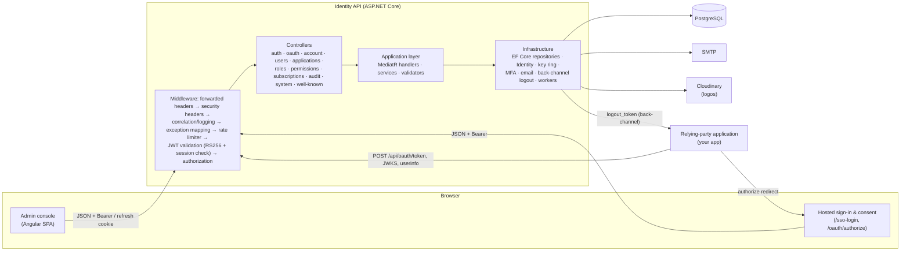
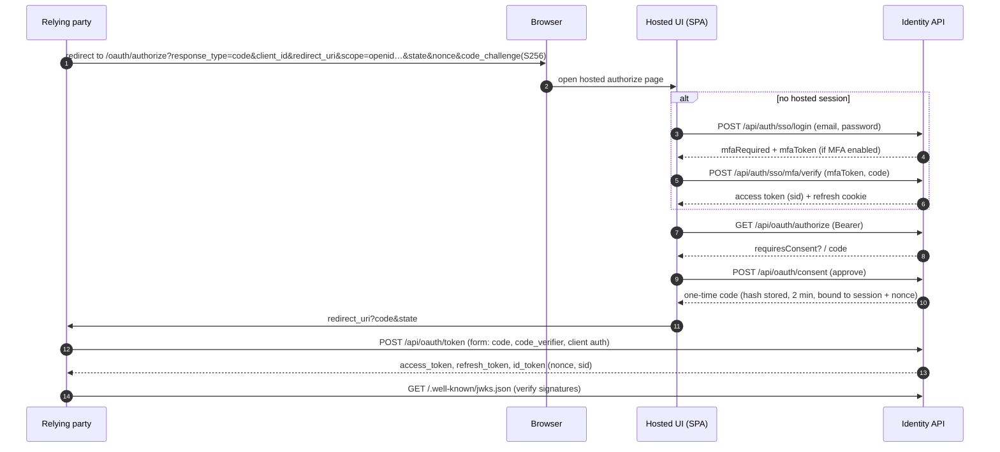
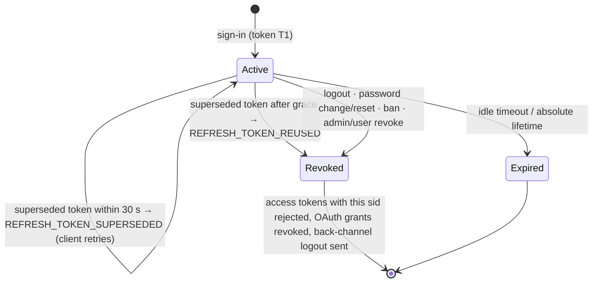
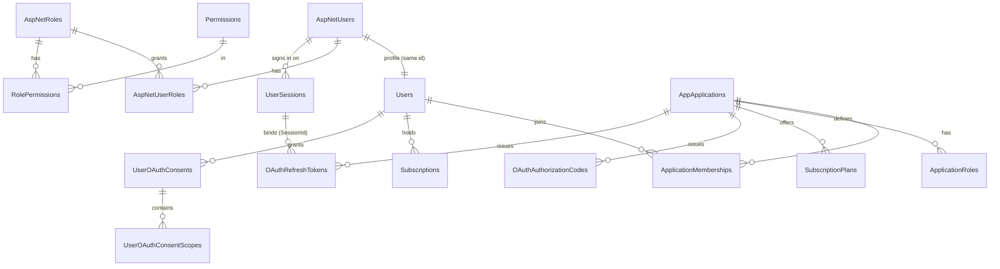

# Enterprise SSO

A self-hosted identity provider and administration console: single sign-on for your own applications over
OAuth 2.0 (authorization code + PKCE) with OpenID Connect ID tokens, server-side sessions, TOTP multi-factor
authentication, role/permission-based access control, application memberships and subscriptions, and a full
security audit trail.

| Part | Path | Stack |
|---|---|---|
| Identity API | [`user-manager-be/`](user-manager-be) | .NET 10, ASP.NET Core, EF Core 10 + PostgreSQL, ASP.NET Core Identity, MediatR, FluentValidation, Serilog |
| Admin console & hosted sign-in UI | [`user-manager-fe/`](user-manager-fe) | Angular 19 (standalone components, signals), Tailwind CSS 3 |

---

## Contents

1. [Features](#features)
2. [Architecture](#architecture)
3. [Authentication and authorization flows](#authentication-and-authorization-flows)
4. [Database design](#database-design)
5. [API reference](#api-reference)
6. [Configuration](#configuration)
7. [Local development](#local-development)
8. [Database migrations](#database-migrations)
9. [Docker deployment](#docker-deployment)
10. [Testing](#testing)
11. [Security model and production checklist](#security-model-and-production-checklist)
12. [Known limitations](#known-limitations)

---

## Features

**Single sign-on (OAuth 2.0 / OpenID Connect)**
- Authorization code flow with **mandatory PKCE (S256)**; `response_type=code` only.
- Hosted sign-in and consent screens (`/sso-login`, `/oauth/authorize`) with per-user, per-application scope consent.
- **ID tokens** (`openid` scope) with `nonce`, `sid`, `auth_time`, `amr`, and `email`/`profile` claims by scope.
- Standard **form-encoded token endpoint** (RFC 6749 responses, `client_secret_basic` / `client_secret_post` / public clients);
  the legacy JSON body format is still accepted.
- **UserInfo** endpoint, **token revocation** (RFC 7009), **discovery** (`/.well-known/openid-configuration`) and **JWKS**.
- Authorization codes are hashed at rest, expire after 2 minutes and are single-use under concurrency;
  **replaying a code revokes the tokens issued from it** (RFC 6749 §4.1.2).
- Rotating refresh tokens; **reuse of a rotated refresh token revokes the token family** for that client.
- **Single logout**: OAuth grants are bound to the hosted SSO session; ending the session revokes them and sends an
  **OIDC Back-Channel Logout** token (`logout+jwt`) to every affected application that registered a back-channel URI.

**Sessions and tokens**
- Every sign-in creates a server-side **session** (device). Access tokens are short-lived (15 min) RS256 JWTs carrying the
  session id (`sid`); revoking a session rejects its access tokens immediately (validation cache ≤ 15 s).
- Refresh tokens are opaque 256-bit values in an `HttpOnly` cookie scoped to `/api/auth`, rotated on every use,
  stored only as SHA-256 hashes, with **reuse detection** (replaying a superseded token revokes the session) and a
  30-second grace window for concurrent tabs.
- Idle timeout (default 7 days) and absolute lifetime (default 30 days) per session.
- Users can list and sign out individual devices; administrators can sign a user out everywhere.
- Password change signs out other sessions; password reset, ban and admin action revoke all sessions and OAuth grants.

**Signing keys**
- Database-backed **RS256 key ring**; private keys encrypted with ASP.NET Core Data Protection.
- Automatic rotation (default every 90 days), manual rotation and emergency revocation from the console; retired keys
  stay in the JWKS for a retention window (default 7 days) so issued tokens keep validating.

**Multi-factor authentication**
- TOTP (RFC 6238, compatible with Google Authenticator, Microsoft Authenticator, 1Password…), enrolment by QR code.
- **Replay protection**: each accepted code's time-step is recorded and cannot be reused.
- 10 single-use **recovery codes**, stored as SHA-256 hashes, regenerable.
- MFA applies to console sign-in, hosted SSO sign-in and email magic links; failed codes count towards account lockout.
- Administrators can reset a user's MFA (lost device). Non-interactive legacy grants are refused for MFA-enabled accounts.

**Identity and access management**
- Users (console accounts and managed SSO accounts), registration with email verification, passwordless email links,
  password reset.
- Global roles with permissions (`RESOURCE.ACTION`, `RESOURCE.*` wildcards), permission catalog, role ↔ permission mapping.
- Applications (OAuth clients: public or confidential, redirect-URI allow-list, back-channel logout URI, logo),
  application roles and memberships, one-time-visible client secrets with rotation.
- Subscription plans per application (pricing, quotas, features) and per-member subscriptions that drive entitlements.

**Security operations**
- **Audit log** of authentication, session, MFA, OAuth, user, application and key events with actor, target, IP, user
  agent, session and correlation id; filterable, exportable to CSV (formula-injection safe), retention (default 365 days).
- Per-user sign-in history and active sessions.
- Dashboard: user/MFA/session/application metrics and 14-day sign-in success/failure chart.
- Rate limiting per client IP (global and a stricter policy for credential endpoints), account lockout
  (5 failures → 5 minutes), security headers, trusted-proxy-only `X-Forwarded-*`, liveness/readiness health checks,
  structured JSON logging with correlation ids.

**Admin console**
- Light and dark themes (follows the OS until changed), responsive down to phone width, English / Tiếng Việt / 中文
  (English is the complete base; untranslated strings fall back to English).

---

## Architecture



The backend follows a layered (clean) architecture, enforced by an architecture test:

```
user-manager-be/
├── UserService.Domain/          Entities, value objects, domain events, repository interfaces (no EF/ASP.NET)
├── UserService.Application/     Use cases (MediatR commands/queries), services (sessions, tokens, OAuth, audit, TOTP),
│                                DTOs, configuration, validators (no EF/Infrastructure)
├── UserService.Infrastructure/  EF Core DbContext, configurations, migrations, repositories, Identity integration,
│                                signing-key ring, MFA, email, outbox & security maintenance workers, seeders
├── UserService.Api/             Controllers, middleware, authentication/authorization, rate limiting, health, Program.cs
└── UserService.Tests/           Unit tests + WebApplicationFactory integration tests

user-manager-fe/src/app/
├── core/        services (auth, oauth, security, users, …), interceptors, guards, models, i18n
├── layout/      application shell (sidebar, top bar, breadcrumbs, menus)
├── shared/      design-system components (drawer, dialog, toast, tables, charts, auth shell, MFA step, …)
└── pages/       login/*, dashboard, users, applications, roles, permissions, role-permission,
                 audit-logs, system, account, billing/*
```

Background workers in the API process:
- **Outbox processor** – delivers domain events (e.g. verification emails) reliably after commit.
- **Security maintenance** – reloads the key ring every 5 minutes (and rotates when due), hourly purges expired sessions,
  authorization codes and refresh tokens, and enforces audit-log retention.

---

## Authentication and authorization flows

### Single sign-on for a relying party



### Refresh-token rotation and reuse detection



### Console sign-in with MFA

1. `POST /api/auth/login` verifies the password (with lockout). Account status is only disclosed after the password is
   correct; unknown users and wrong passwords return the same `401 INVALID_CREDENTIALS`.
2. If MFA is enabled the response is `{ mfaRequired: true, mfaToken }` — no tokens, no cookie. The `mfaToken` is a
   Data-Protection-encrypted, 5-minute challenge.
3. `POST /api/auth/mfa/verify` with a TOTP or recovery code opens the session and returns the access token
   (`amr=mfa`) plus the refresh cookie.

### Authorization

- Endpoints use permission policies (`HasPermission:USER.READ`, …). Permissions come from the user's roles
  (and, for application-scoped tokens, application role + subscription plan); `SuperAdmin`/`Admin` are seeded with all.
- Authenticated callers without a permission receive `403`; unauthenticated callers `401` (consistent JSON body).
- The console additionally requires the `Admin` or `SuperAdmin` role.
- Application access for OAuth requires an active membership and active subscription (`SuperAdmin` bypasses).

---

## Database design

PostgreSQL schema managed by EF Core migrations (`UserService.Infrastructure/Migrations`). Main tables:



| Table | Purpose |
|---|---|
| `AspNetUsers`, `AspNetRoles`, `AspNetUserRoles`, `AspNetUserTokens` | ASP.NET Core Identity: credentials (PBKDF2 hashes), lockout, `TwoFactorEnabled`, `LastTotpTimeStep`, authenticator key and hashed recovery codes |
| `Users` | Domain profile (name, username, SSO flag, preferences) |
| `UserSessions` | One row per signed-in device: current + previous refresh-token hash, kind, auth method, IP, user agent, idle/absolute expiry, revocation reason, concurrency token |
| `Permissions`, `RolePermissions` | Permission catalog and global role grants |
| `AppApplications`, `ApplicationRoles`, `ApplicationMemberships`, `ApplicationOAuthScopes` | OAuth clients (client id, BCrypt-hashed secret, redirect URIs, back-channel URI), roles and members |
| `OAuthAuthorizationCodes` | Code hash, PKCE challenge, nonce, session id, expiry, consumption (concurrency token) |
| `OAuthRefreshTokens` | Token hash, scopes, session id, expiry, revocation reason (`rotated` enables reuse detection) |
| `UserOAuthConsents`, `UserOAuthConsentScopes` | Remembered consent per user/application |
| `SubscriptionPlans`, `PlanFeatures`, `SubscriptionPlanPermissions`, `Subscriptions`, `ApplicationSubscriptions`, `Features` | Plans, entitlements and subscriptions |
| `MagicLinkTokens` | Email links (verification, reset, passwordless) — SHA-256 hash only, 15 min, single use |
| `AuditLogs` | Immutable security events, indexed by time, event type, category, actor and target |
| `SigningKeys` | RS256 key ring (public PEM, Data-Protection-encrypted private key, retired/revoked timestamps) |
| `DataProtectionKeys` | ASP.NET Core Data Protection key ring shared by all instances |
| `OutboxMessages` | Transactional outbox for domain events |
| `OpenIddict*` | Optional legacy `/connect/token` endpoint |

Concurrency-sensitive one-time artifacts (sessions, codes, refresh tokens, magic links) use optimistic concurrency
tokens so that a token can only be redeemed or rotated once even under parallel requests.

---

## API reference

All JSON endpoints use the envelope `{ success, data, message, error: { code, message, errors } }`
(paged lists add `totalCount`, `pageNumber`, `pageSize`). Error `code` values are stable
(e.g. `INVALID_CREDENTIALS`, `ACCOUNT_LOCKED`, `INVALID_MFA_CODE`, `REFRESH_TOKEN_REUSED`, `RATE_LIMITED`, `FORBIDDEN`).
Swagger UI is available at `/swagger` when `AppSettings:Swagger:Enabled=true`.

### Authentication — `/api/auth`
| Method | Path | Notes |
|---|---|---|
| POST | `/register` | Self-registration (User role); sends verification email |
| POST | `/login` | Console sign-in; may return `mfaRequired` |
| POST | `/mfa/verify` | Complete console sign-in with TOTP/recovery code |
| POST | `/sso/login`, `/sso/mfa/verify` | Hosted SSO sign-in (SSO accounts) |
| POST | `/refresh` | Rotate refresh cookie; requires `X-Requested-With` when using the cookie |
| POST | `/logout` | `{ allSessions?: bool }`; revokes session(s), OAuth grants, back-channel logout |
| POST | `/passwordless/request`, `/magic-link/verify`, `/magic-link/resend` | Email links |
| GET/POST | `/verify-email` | Email verification |
| POST | `/password/reset-request`, `/password/reset`, `/password/change` | Password lifecycle |

### OAuth 2.0 / OIDC
| Method | Path | Notes |
|---|---|---|
| GET | `/.well-known/openid-configuration` (also `/.well-known/oauth-authorization-server`) | Discovery |
| GET | `/.well-known/jwks.json` | Public signing keys |
| GET | `/api/oauth/authorize` | Called by the hosted UI with the user's hosted-SSO token |
| POST | `/api/oauth/consent` | Approve requested scopes |
| POST | `/api/oauth/token` | `authorization_code` / `refresh_token`; form (RFC 6749) or JSON |
| GET/POST | `/api/oauth/userinfo` | Claims by granted scope |
| POST | `/api/oauth/revoke` | RFC 7009 |

Example token exchange:

```bash
curl -s https://auth.example.com/api/oauth/token \
  -d grant_type=authorization_code -d client_id=my-app \
  -d redirect_uri=https://app.example.com/callback \
  -d code="$CODE" -d code_verifier="$VERIFIER"
# {"access_token":"…","token_type":"Bearer","expires_in":900,"refresh_token":"…","scope":"openid profile email","id_token":"…"}
```

Back-channel logout: the API POSTs `logout_token=<JWT>` (form) to the application's back-channel URI. The JWT is
signed with the JWKS keys, `aud` is the client id, and it carries `sub`, `sid`, `jti` and the
`http://schemas.openid.net/event/backchannel-logout` event.

### Self-service — `/api/account` (authenticated)
`GET /sessions` · `DELETE /sessions/{id}` · `POST /sessions/revoke-others` · `GET /mfa` · `POST /mfa/setup` ·
`POST /mfa/enable` · `POST /mfa/disable` · `POST /mfa/recovery-codes` · `GET /activity`

### Administration
| Area | Endpoints | Permission |
|---|---|---|
| Users | `GET /api/users?search&type=sso\|console`, `GET /api/users/{id}`, `GET /api/users/me`, roles add/remove, `POST /api/users/sso`, SSO app grants, ban/unban | `USER.READ` / `USER.MANAGE` / `ROLE.MANAGE` |
| User security | `GET /api/users/{id}/sessions`, `POST /api/users/{id}/sessions/revoke`, `GET /api/users/{id}/mfa` | `USER.READ` / `USER.MANAGE` |
| | `POST /api/users/{id}/mfa/reset` | `SECURITY.MANAGE` |
| Applications | CRUD, members, credentials, secret rotation, logo, `/{id}/roles`, `/{id}/me/capabilities` | `APPLICATION.*`, `USER.MANAGE`, `ROLE.*` |
| Roles / permissions | `/api/roles`, `/api/permissions`, `/api/permissions/{roleId}/permissions[/batch]` | `ROLE.*`, `PERMISSION.*` |
| Subscriptions | `/api/subscriptions/plans`, `activate`, `upgrade`, `extend`, `cancel`, `active`, `history` | `SUBSCRIPTION.*` |
| Audit | `GET /api/audit-logs?search&category&succeeded&userId&from&to`, `GET /api/audit-logs/export` | `AUDIT_LOG.READ` |
| Dashboard | `GET /api/dashboard/summary` | `USER.READ` |
| Keys & policy | `GET /api/system/signing-keys`, `POST …/rotate`, `POST …/{kid}/revoke`, `GET /api/system/security-settings` | `SECURITY.READ` / `SECURITY.MANAGE` |
| Files | `POST /api/files/upload`, `DELETE /api/files` | application permissions |

### Health
`GET /health/live` (process up) · `GET /health/ready` and `GET /health` (database reachable and signing key loaded; `503` otherwise).

---

## Configuration

The API uses standard ASP.NET Core configuration: `appsettings.json` provides defaults and every value can be
overridden with environment variables using `__` as separator (e.g. `AppSettings__Jwt__Issuer`).
The connection string is resolved from `ConnectionStrings__UserDatabase`, then `DATABASE_URL`, then
`POSTGRES_HOST/PORT/DB/USER/PASSWORD`.

| Setting | Default | Description |
|---|---|---|
| `ConnectionStrings__UserDatabase` | — | **Required.** Npgsql connection string |
| `AppSettings__Environment` | `Production` | `Development` enables dev certificates/demo seeding |
| `AppSettings__ApiPublicBaseUrl` | request host | Public API URL used in discovery |
| `AppSettings__FrontendBaseUrl` | — | **Required.** Console/hosted UI URL (email links, authorize endpoint, CORS fallback) |
| `AppSettings__Jwt__Issuer` / `__Audience` | — | **Required.** Use the public API URL as issuer for OIDC consistency |
| `AppSettings__Jwt__AccessTokenExpirationMinutes` | `15` | Access/ID token lifetime |
| `AppSettings__Jwt__RefreshTokenExpirationDays` | `7` | Session idle timeout and OAuth refresh-token lifetime |
| `AppSettings__Security__SessionAbsoluteLifetimeDays` | `30` | Maximum session age |
| `AppSettings__Security__RefreshTokenReuseGraceSeconds` | `30` | Multi-tab grace window |
| `AppSettings__Security__SessionValidationCacheSeconds` | `15` | Revocation propagation delay across instances |
| `AppSettings__Security__MfaChallengeMinutes` | `5` | MFA step lifetime |
| `AppSettings__Security__AuditLogRetentionDays` | `365` | `0` disables purging |
| `AppSettings__Security__SigningKeys__RotationDays` | `90` | `0` disables automatic rotation |
| `AppSettings__Security__SigningKeys__RetiredKeyRetentionDays` | `7` | Must exceed access-token lifetime |
| `AppSettings__Security__ForwardedHeaders__KnownProxies__N` / `__KnownNetworks__N` | — | Trusted reverse proxies (IP / CIDR) |
| `AppSettings__Security__DataProtectionCertificatePath` / `…Password` | — | PFX that encrypts Data Protection keys at rest |
| `AppSettings__RateLimit__RequestLimit` / `__WindowSeconds` | `100` / `60` | Global per-IP limit |
| `AppSettings__RateLimit__AuthRequestLimit` / `__AuthWindowSeconds` | `10` / `60` | Credential endpoints per IP |
| `AppSettings__Cors__AllowedOrigins__N` | — | Allowed SPA origins (credentials allowed) |
| `AppSettings__OAuth__AllowedRedirectUriHosts__N`, `__DefaultApplicationAllowedRedirectUris__N` | — | Redirect-URI policy and seeded console client |
| `AppSettings__Cloudinary__CloudName` / `__ApiKey` / `__ApiSecret` | — | **Required** (logo uploads) |
| `EmailSettings__Smtp__*`, `EmailSettings__Sender__*` | — | SMTP delivery |
| `Admin__Email` / `Admin__Password` | — | Bootstrap SuperAdmin created on first start |
| `SEED_APP_NAME`, `SEED_APP_API_KEY` | — | Seeded first-party application (the console's OAuth client id) |
| `SEED_DEMO_USERS` + `SEED_TEST_USER_*`, `SEED_SSO_USER_*` | off outside Development | Demo SuperAdmin accounts — never enable in production |
| `AppSettings__OpenIddict__*` | password/magic-link grants off | Optional legacy `/connect/token` |
| `LOG_FORMAT=json` | text | Compact JSON (CLEF) console logs |

Frontend build-time variables (`user-manager-fe/.env`, consumed by `@ngx-env/builder`):

| Variable | Example |
|---|---|
| `NG_APP_API_URL` | `http://localhost:5004` |
| `NG_APP_OAUTH_CLIENT_ID` | `user-manager` (must match `SEED_APP_API_KEY`) |
| `NG_APP_OAUTH_REDIRECT_URI` | `http://localhost:4200/oauth/callback` |

---

## Local development

Prerequisites: .NET SDK 10, Node.js 20+, PostgreSQL 16 (local or `docker compose up -d postgres`).

**API**

```bash
cd user-manager-be
export ASPNETCORE_ENVIRONMENT=Development AppSettings__Environment=Development
export ConnectionStrings__UserDatabase="Host=localhost;Port=5432;Database=sso;Username=postgres;Password=postgres"
export AppSettings__FrontendBaseUrl=http://localhost:4200 AppSettings__ApiPublicBaseUrl=http://localhost:5004
export AppSettings__Jwt__Issuer=http://localhost:5004 AppSettings__Jwt__Audience=enterprise-sso-api
export AppSettings__Cors__AllowedOrigins__0=http://localhost:4200
export AppSettings__Cloudinary__CloudName=demo AppSettings__Cloudinary__ApiKey=demo AppSettings__Cloudinary__ApiSecret=demo
export Admin__Email=admin@example.com Admin__Password='Change-Me-0n-First-Login!'
export SEED_APP_NAME=user-manager SEED_APP_API_KEY=user-manager SEED_APP_DESCRIPTION="Admin console"
dotnet run --project UserService.Api --urls http://localhost:5004
```

With `AppSettings__IsAutoMigrate=true` (the default in `appsettings.json`) the API applies migrations and seeds roles,
permissions, the admin user and the console application on start. The first start also creates the RS256 signing key.

**Console**

```bash
cd user-manager-fe
cp .env.example .env    # set NG_APP_API_URL=http://localhost:5004
npm ci
npm start               # http://localhost:4200
```

---

## Database migrations

```bash
dotnet tool install --global dotnet-ef --version 10.0.7
cd user-manager-be
# create a migration after changing the model
dotnet ef migrations add <Name> --project UserService.Infrastructure --startup-project UserService.Api
# apply (or rely on AppSettings__IsAutoMigrate=true)
dotnet ef database update --project UserService.Infrastructure --startup-project UserService.Api
# generate an idempotent script for CI/CD
dotnet ef migrations script --idempotent --project UserService.Infrastructure --startup-project UserService.Api -o migrate.sql
```

The design-time host needs the same configuration as a normal start (connection string, JWT issuer/audience, Cloudinary).

Upgrade note for `EnterpriseSecurityHardening`: the per-user refresh token column is replaced by `UserSessions`, so every
user signs in again after the upgrade; outstanding authorization codes are deleted and outstanding email links are
invalidated (they were stored in plaintext). Existing OAuth refresh tokens remain valid (they were already hashed).

---

## Docker deployment

```bash
cp .env.example .env          # fill in passwords, admin account, Cloudinary, SMTP, public URLs
docker compose up -d --build  # postgres + api (:5004) + web console (:8080)
```

- `user-manager-be/UserService.Api/Dockerfile` – multi-stage build, runs as the non-root `app` user, JSON logs,
  `HEALTHCHECK` on `/health/live`.
- `user-manager-fe/Dockerfile` – builds the SPA with the `NG_APP_*` build args and serves it from
  `nginx-unprivileged` with SPA fallback, immutable asset caching and security headers.
- The compose file refuses to start without `POSTGRES_PASSWORD`, `ADMIN_EMAIL`, `ADMIN_PASSWORD` and Cloudinary settings.
- Behind a TLS-terminating proxy set `TRUSTED_PROXY_NETWORK` (CIDR) so client IPs and `https` are taken from
  `X-Forwarded-*`; without it forwarded headers are ignored (only loopback proxies are trusted).
- Run more than one API instance only with a shared database (Data Protection keys, key ring and sessions are in PostgreSQL);
  note that rate-limit counters are per instance.

---

## Testing

```bash
cd user-manager-be && dotnet test          # 83 tests
cd user-manager-fe && npm run build        # type-checks all templates (no unit tests in the SPA)
```

The backend suite contains:
- **Unit tests** – RFC 6238 test vectors and TOTP replay rules, Base32, session rotation/expiry/grace logic,
  refresh-token reuse detection (session revocation, OAuth grant revocation, back-channel notification, audit),
  concurrent-rotation handling, RS256 tokens (kid, `at+jwt`, audience, key rotation/retirement, ID token claims,
  back-channel logout token), plus the pre-existing domain/service/architecture tests.
- **Integration tests** (`WebApplicationFactory` over the real pipeline with EF InMemory) – discovery/JWKS, health,
  uniform failed-login responses, RS256 + `sid` access tokens, refresh reuse revoking the victim's session,
  CSRF header enforcement, logout invalidating access tokens, 403 vs 401 authorization, MFA enrolment → challenge →
  replay rejection → single-use recovery codes, OAuth code flow with PKCE, ID-token `nonce`/`aud`/`sid`, and
  authorization-code replay revoking issued refresh tokens.

InMemory does not support `ExecuteDelete`, so the maintenance worker is disabled in tests; the migrations themselves
were verified against PostgreSQL 16.

---

## Security model and production checklist

What the platform does for you:
- Passwords: ASP.NET Core Identity (PBKDF2), policy ≥ 8 chars with upper/lower/digit/symbol, lockout after 5 failures.
- Client secrets: BCrypt (work factor 12), shown once. Refresh tokens, authorization codes, magic links, recovery
  codes: SHA-256 hashes of 256/60-bit random values. Signing keys: encrypted with Data Protection.
- Tokens: RS256 only (`alg` pinned), issuer/audience/lifetime validated, 30 s clock skew, session-bound.
- Browser: refresh token in `HttpOnly` cookie limited to `/api/auth` (`Secure; SameSite=None` over HTTPS); cookie
  endpoints require `X-Requested-With`; access token kept in `sessionStorage`; CORS restricted to configured origins.
- API responses carry `X-Content-Type-Options`, `X-Frame-Options: DENY`, `Referrer-Policy: no-referrer`, a restrictive
  CSP and `Cache-Control: no-store` on auth/account endpoints; HSTS and HTTPS redirection outside Development.

Before going live:
- [ ] Serve API and console over **HTTPS only**; set `Jwt:Issuer` to the public API URL.
- [ ] Configure `TRUSTED_PROXY_NETWORK` for your load balancer.
- [ ] Provide `DataProtectionCertificatePath` so Data Protection (and therefore signing keys and MFA challenges) are encrypted at rest.
- [ ] Use strong, unique `POSTGRES_PASSWORD` and `ADMIN_PASSWORD`; change the admin password and **enable MFA** on first login.
- [ ] Keep `SEED_DEMO_USERS=false`; keep OpenIddict password/magic-link grants and anonymous clients disabled unless needed.
- [ ] Register exact redirect URIs (HTTPS) for every application; configure back-channel logout URIs.
- [ ] Configure SMTP (verification, reset and magic links depend on it) and Cloudinary.
- [ ] Prefer running migrations from CI (`migrations script --idempotent`) and set `AppSettings__IsAutoMigrate=false`.
- [ ] Ship `LOG_FORMAT=json` logs to your aggregator; alert on `auth.token.reuse_detected`, `oauth.code.replay_detected`,
      `oauth.refresh.reuse_detected` and bursts of `auth.login.failed`.
- [ ] Back up PostgreSQL (it holds the key ring and Data Protection keys — losing them invalidates sessions and keys).
- [ ] Keep Swagger disabled or restricted in production.

---

## Known limitations

These are deliberate scope boundaries or open items, not hidden features:

- **No organizations / multi-tenancy model.** Applications (with memberships, roles and subscriptions) are the
  isolation boundary.
- No SAML, SCIM, WebAuthn/passkeys, social/external identity providers, device-code or client-credentials grants in the
  primary OAuth flow. The OIDC implementation covers the authorization-code flow, ID token, UserInfo, discovery, JWKS,
  revocation and back-channel logout; it has not been run against the OpenID certification suite.
- The `authorization_endpoint` is the hosted SPA page, which calls the JSON API; it is not a server-rendered endpoint.
- TOTP secrets live in Identity's token store; they are protected by database access controls, not by additional
  application-level encryption.
- Session revocation reaches other API instances within `SessionValidationCacheSeconds` (default 15 s); relying parties
  that validate tokens locally learn about logout through back-channel logout or token expiry.
- Rate limiting is in-memory per instance.
- The SPA is on Angular 19; `npm audit` still reports advisories (13 high, 1 critical, mostly build tooling) whose fixes
  require the Angular 21/22 major upgrade.
- The legacy OpenIddict `/connect/token` endpoint is kept for compatibility (hardened, most grants disabled by default);
  new integrations should use `/api/oauth/*`.
